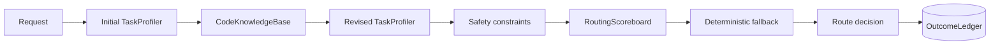

# Routing Intelligence and Evaluation



## Profiling

Task dimensions use a bounded 0–100 scale; confidence uses 0–1. The profiler estimates scope, ambiguity, architectural impact, verification difficulty, security risk, and context uncertainty. Initial profiling uses request signals. Revised profiling incorporates ranked repository evidence, relevant paths and symbols, and whether associated tests were found.

Complexity is an estimate, not ground truth. The score is a weighted sum with explicit floors for security and architectural impact. Weights are configurable under `intelligence.complexity_weights`.

## Retrieval

`CodeKnowledgeBase` builds on TGV's confined lexical index and Python AST symbol extraction. Results expose lexical, semantic, graph, and final scores plus bounded excerpts and estimated token cost. Semantic retrieval is optional; when unavailable, its score is zero and the pipeline continues locally with lexical and structural evidence.

Repository content is untrusted evidence. Denied files, binary files, oversized files, and root-escaping symlinks remain excluded.

## Outcome ledger

The SQLite ledger stores hashes, normalized categories, file paths, symbol identifiers, aggregate metrics, and validation outcomes. It does not store source code. Raw request retention is disabled unless `intelligence.retain_raw_prompts` is explicitly enabled. Schema version 1 is initialized transactionally.

## Scoreboard

Candidates are segmented by task category, model identifier, and capability tier. Success probability uses a Beta(1,1) prior:

`p_success = (successes + 1) / (samples + 2)`

Expected utility is the visible sum of success, quality, human acceptance, cost, latency, rework, retry, and safety components. Candidates below `scoreboard_minimum_samples` are reported but cannot replace the deterministic router. Safety constraints always override optimization.

Historical model performance may not generalize to new repositories. The scoreboard requires sufficient observations and should be treated as decision support, not ground truth.

## CLI

```bash
tgv profile "Fix refresh-token rotation" --repo . --json
tgv retrieve "AuthenticationService" --repo . --json
tgv scoreboard "Fix refresh-token rotation" --repo . --json
tgv explain "Fix refresh-token rotation" --repo .
tgv outcomes list --repo .
tgv outcomes export --repo . --format csv
tgv benchmark run --enforce --json
tgv benchmark outcomes --repo . --json
```

## Benchmark scope

The integrated benchmark reports category accuracy, complexity-band accuracy, acceptable-route accuracy, and false-low-risk rate over synthetic, non-confidential cases. It is a local regression diagnostic, not a universal performance claim.

## Integrated release benchmark

TGV 0.32 ships 104 curated synthetic cases across all 13 task categories and low/medium/high complexity bands. `tgv benchmark run --enforce --json` applies the release gate used by CI: at least 100 cases, at least 90% task-category accuracy, at least 90% complexity-band accuracy, at least 95% acceptable-route accuracy, and zero false-low-risk cases. The corpus is a regression/evaluation set, not evidence of universal production accuracy.


## Observed outcome benchmark

`tgv benchmark outcomes --repo . --json`

The outcome benchmark is intentionally separate from the curated release corpus. It reads the repository-scoped privacy-minimal SQLite ledger and reports verified success, human acceptance, rework, retries, safety violations, latency, and estimated cost by selected model, capability tier, and task category. A completed task without tests/static/human/rework evidence is treated as unverified rather than successful.

Use `--enforce` only when the deployment has enough representative observations. The default gate requires 20 verified outcomes, at least 85% verified success, and zero observed safety violations. These defaults are operational guardrails, not universal model-quality claims.

## Counterfactual explanations

`tgv explain REQUEST --repo .` keeps the raw decision available while adding a human-readable answer to “what would make another route win?”. It derives deterministic request-signal counterfactuals and calls out cases where safety policy or historical scoreboard evidence, rather than raw request scores, controls the effective selection. Counterfactuals explain current routing logic; they do not predict model quality.
